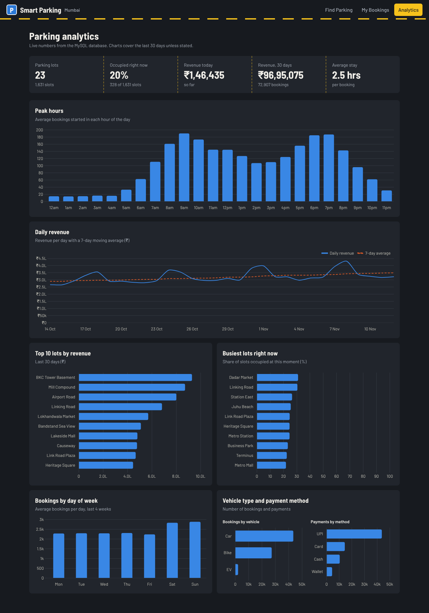
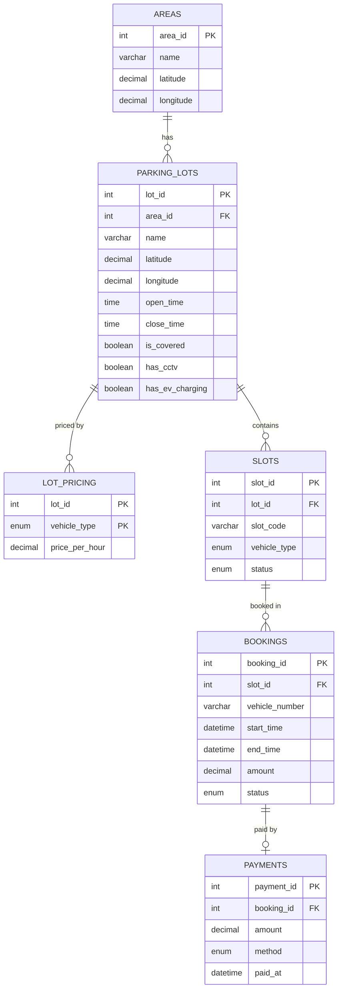

# Smart Car Parking Management System

A web app that shows parking lots on a map of Mumbai, finds the nearest one to you, and tells you the price and how many slots are free. You can book a slot, check out and pay, and an analytics page turns the booking data into charts.

Built with **MySQL, Python (Flask), JavaScript and Leaflet maps**.



## Features

**Find Parking (map page)**
- Parking lots shown as pins on an OpenStreetMap map; the number on each pin is the count of free slots
- Pin colour shows status: green = free, yellow = filling up, red = full
- Finds the nearest lots to your location (GPS, a chosen area, or a click on the map), sorted by distance
- Filters: car / bike / EV charging, distance, maximum price, covered parking, free slots only
- Price per hour, opening hours, CCTV and EV charging shown for every lot
- One-click directions in Google Maps
- Availability refreshes every 30 seconds

**Booking**
- Book a slot with your name and vehicle number; the system assigns a free slot
- A database transaction stops two people from getting the same slot
- Check out from "My Bookings": the bill is calculated per started hour and the slot becomes free again

**Analytics dashboard**
- Live occupancy, revenue today and revenue for the last 30 days
- Peak hours, daily revenue with a 7-day moving average, top lots by revenue, busiest lots, bookings by weekday, vehicle mix and payment methods

**SQL analysis**
- `sql/analysis_queries.sql` has 13 queries that answer business questions using joins, GROUP BY, subqueries, CTEs and window functions (RANK, LAG, moving average, running total)

## Tech stack

| Part | Technology |
|---|---|
| Database | MySQL 8 (also works on MariaDB) |
| Backend | Python 3, Flask, PyMySQL |
| Frontend | HTML, CSS, JavaScript |
| Map | Leaflet + OpenStreetMap (free, no API key needed) |
| Charts | Chart.js |

## Database design



There is also a view, `v_lot_availability`, that gives total and free slots for each lot and vehicle type.

## How "nearest parking" works

The browser sends your latitude and longitude to the backend. One SQL query calculates the distance from you to every lot with the **Haversine formula** (distance between two points on the Earth), joins the price and live availability, and returns the lots sorted by distance. See `api_lots()` in `app.py`.

## How to run it

You need **Python 3.9+** and **MySQL 8** (or MariaDB) installed and running.

```bash
# 1. Download the project
git clone https://github.com/Arnav007-44/Smart-Parking-Systems.git
cd Smart-Parking-Systems

# 2. Install the Python packages
pip install -r requirements.txt

# 3. Put your MySQL password in config.py (DB_PASSWORD)

# 4. Create the database and sample data (takes a few seconds)
python setup_db.py

# 5. Start the app
python app.py
```

Then open **http://localhost:5001** in your browser.

To try the analysis queries, open `sql/analysis_queries.sql` in MySQL Workbench and run them one at a time.

## Project structure

```
smart-parking/
├── app.py                  Flask backend: pages and JSON API
├── config.py               Database settings
├── setup_db.py             Creates tables and generates sample data
├── requirements.txt
├── sql/
│   ├── schema.sql          Tables, keys, indexes and the view
│   └── analysis_queries.sql  13 analysis queries
├── templates/              HTML pages (map, bookings, dashboard)
└── static/
    ├── css/style.css
    ├── js/                 map.js, bookings.js, dashboard.js, common.js
    └── vendor/             Leaflet, Chart.js and the Barlow font
```

## API

| Method | URL | What it does |
|---|---|---|
| GET | `/api/lots?lat=&lng=&vehicle_type=&radius_km=&max_price=` | Nearby lots with price, free slots and distance |
| GET | `/api/lots/<id>` | One lot with prices and availability for every vehicle type |
| GET | `/api/areas` | List of areas |
| POST | `/api/bookings` | Book a slot |
| GET | `/api/bookings?vehicle_number=` | Bookings for a vehicle |
| POST | `/api/bookings/<id>/checkout` | Check out, pay and free the slot |
| GET | `/api/analytics` | All numbers for the dashboard |

## About the data

This is an academic project. **All parking lots, prices and bookings are sample data** generated by `setup_db.py` (23 lots, about 1,600 slots and 60 days of booking history). The lot names are invented; only the Mumbai area names are real. The generator follows realistic patterns (morning and evening peaks, busier weekends) so that the analysis has something to find.

## Possible improvements

- User login and an admin page to add or edit lots
- Real-time slot sensors (IoT) instead of manual check-in and check-out
- Online payment gateway
- Demand-based pricing during peak hours

## How this was built

This project was built with AI assistance (Claude). I use it to study database design, SQL analysis and how a web app talks to a database, and I am extending it with my own features and queries.

## Author

**Arnav Devalekar** - Computer Engineering, Xavier Institute of Engineering, Mumbai
[LinkedIn](https://linkedin.com/in/arnav-devalekar)
